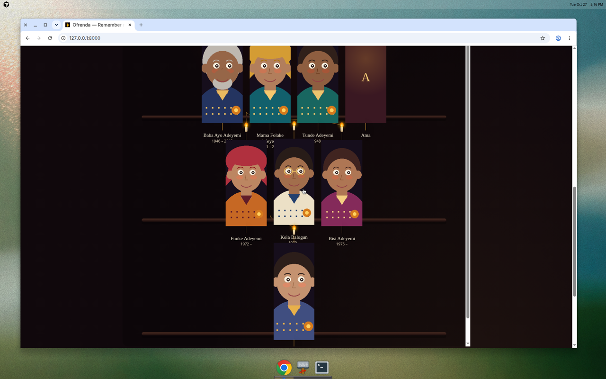
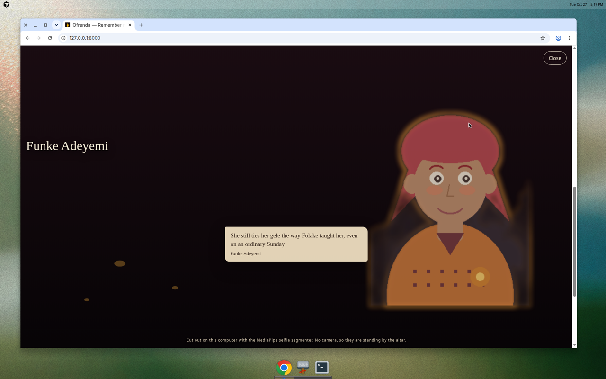

# Ofrenda

**Remember me.**

Ofrenda is a small altar you run on your own laptop. You tell it about your family in ordinary words. A local Gemma model reads the story and sets the people on a tree: who was whose parent, who moved away, where they were from. You can correct it, add a photograph, and write the short memory you are afraid of forgetting.

Then it looks for the missing branches. Someone has a name and a city and nothing else. The altar does not invent a spouse for them. It lights a candle and gives you a question to ask an older relative.

If there is a photograph, you can sit with them. MediaPipe, on the same machine, lifts the person out of the picture. They come back as a soft ghost beside you on the webcam: translucent, marigold at the edges, one memory nearby. It is meant to feel like the room got quiet. Not horror. A visit.

The family already on the altar is fictional. The Adeyemis are a stage, so anyone can try the candles before typing a real name. Nothing in this repository is a photograph of a real person.





These stills were taken with the built-in stand-in storyteller, so the status line says no Gemma is loaded. With Ollama running, that line names the model, and Gemma rewrites the candle questions. The tree, the facts on the candles, and the ghost are the same either way.

A short GIF or screen recording belongs in the DEV post. [docs/DEMO.md](docs/DEMO.md) is a two-minute script. Replace the stills above if you record your own.

## Why this is offline

In *Coco*, an ancestor fades when the last person who remembers them is gone. A family tree is a poor thing to hand to a server you do not control. Photographs of the dead are not training data. An ofrenda that only works while a company remembers its API key is a bad place to keep your grandmother.

Ofrenda keeps the tree in a JSON file on the laptop (`data/family.json`) and the photographs beside it (`data/portraits/`). There is no account. The webcam frame is drawn in the browser and is never uploaded. Gemma runs through Ollama on the same machine. MediaPipe's selfie segmenter is a small model shipped in this repo, so the cut-out does not call a vision API.

You can swap the language model by changing one environment variable. The altar stays the same.

## Run it

You need Python 3.11 or newer. On Debian or Ubuntu, install the libraries MediaPipe uses to open a portrait:

```bash
sudo apt install python3-venv python3-pip libgl1 libegl1 libglib2.0-0
```

macOS can skip that line unless MediaPipe fails to import.

Then, from this directory:

```bash
./start.sh
```

The first run builds a virtual environment and installs the dependencies. MediaPipe is large, so that install takes a few minutes. After that, open [http://127.0.0.1:8000](http://127.0.0.1:8000).

`./start.sh` is the one command. It is the same as:

```bash
python3 -m venv .venv
source .venv/bin/activate
pip install -r requirements.txt
python -m ofrenda
```

### Gemma, through Ollama

Install [Ollama](https://ollama.com/download), then pull a Gemma model:

```bash
ollama pull gemma2:2b
```

Leave Ollama running. The status line on the altar should say `Gemma · gemma2:2b · on this computer`. The first story can take a while on a CPU. Later ones are quicker once the model is warm.

Use a different Gemma by setting the model name. Copy `.env.example` to `.env` if you like. Anything already in the environment wins.

```bash
OLLAMA_MODEL=gemma3:4b ./start.sh
```

`OLLAMA_HOST` defaults to `http://127.0.0.1:11434`.

### Without Ollama

The altar, the photographs, the candles, and ghost mode all work with no model installed. Story parsing then uses a small built-in stand-in that only understands a few sentence shapes. It is there so the tests, and a laptop that does not have Ollama yet, can still run.

```bash
OFRENDA_MOCK_LLM=1 ./start.sh
```

The status line will say the mock storyteller is on. That is not the real entry. The real storyteller is Gemma.

## How to use it

1. Read the altar. The oldest sit on the highest shelf. Seyi, marked as keeper, is who a story means by "my".
2. Tell a story in the paper at the top. One relationship at a time is enough: "Tunde had a wife called Ama from Accra."
3. Click a person to rename them, write a memory, upload a photograph, or fix a link. "Funke" and "funke" are the same person. "Baba Ayo" is not merged with a different "Ayo". A short name lands on someone already there when it is unambiguous: "Tunde" is Tunde Adeyemi, "Mama" is not guessed, because two Mamas are on the altar.
4. Read the candles. Each one is a gap in the tree and a question you could actually ask. With Gemma running, the questions are rewritten in Gemma's words. The gaps themselves are computed from the tree, so a bad model day cannot erase a missing child.
5. On someone with a photograph, choose **Sit with them**. Allow the camera if you want them beside you. If there is no camera, they stand in a painted night instead. Press Escape or Close to leave.

**Restore the fictional sample** in the footer puts the Adeyemis back and clears your local edits. Your real tree, if you have started one, goes with that. Copy `data/` somewhere safe first if you need it.

Photographs are kept under 8MB and saved as PNG. A real photograph against a plain wall is what the selfie segmenter is trained for. The painted sample portraits are illustrations; MediaPipe still attempts them, and a colour-key fallback cuts them out if the person mask is empty or eats the whole frame.

## The fictional family

| Person | Place | What the altar already knows |
| --- | --- | --- |
| Mama Ireti Adeyemi | Ogbomoso | No spouse recorded |
| Baba Ayo Adeyemi | Ogbomoso | Ireti's son, Folake's husband, a tailor |
| Tunde Adeyemi | Accra | Ayo's brother. A name, a move to Ghana, and no one beside him |
| Mama Folake Adeyemi | Ibadan | Ayo's wife. Her own parents are missing |
| Funke Adeyemi | Lagos | Their daughter |
| Kola Balogun | Lagos | Funke's husband. His parents are missing |
| Bisi Adeyemi | Ibadan | Funke's sister |
| Seyi Balogun | Lagos | Their child, and the keeper of this ofrenda |

The portraits are generated by `scripts/generate_portraits.py`. They are flat retablo-style drawings, not photographs, and not of anyone real. Regenerate them with:

```bash
python scripts/generate_portraits.py
```

## Tests

```bash
python3 -m venv .venv
source .venv/bin/activate
pip install -r requirements-dev.txt
pytest
```

The tests never call Ollama. They cover:

- JSON cleanup, validation, retries, and dedupe of an extraction
- merging a story into a tree without cloning people who are already there
- the missing-branch questions, and the rule that a model may rephrase a question but may not invent a person
- the ghost treatment (translucent, marigold halo, the same float the browser uses) and the segmentation fallbacks

## Tech stack

- **Python, FastAPI, Uvicorn.** The local server. Binds to `127.0.0.1` by default.
- **Gemma through Ollama.** Open-weight language model. The model name is `OLLAMA_MODEL` (default `gemma2:2b`). Used to read a story into people and relationships, and to rewrite the candle questions.
- **MediaPipe selfie segmenter.** The float16 square model is in `models/selfie_segmenter.tflite`. Person confidence becomes a soft mask. See `ofrenda/segment.py` for the channel choice, the usable-mask check, and the colour-key fallback.
- **Pillow and NumPy.** Feathering, the marigold halo, and a still-frame composite that the tests check. The live webcam composite stays in the browser so the frame rate does not depend on uploading video. The float is the same sine in both places (`/api/ghost/motion`).
- **HTML, CSS, and JavaScript.** No frontend framework. One page.

Family data is JSON, not a database. One file is easier to copy onto a drive and put in a drawer.

## Layout

```
ofrenda/          server, extraction, merge, suggestions, segmentation
static/           the page
sample/           fictional family and painted portraits
models/           MediaPipe selfie segmenter
data/             created on first run, gitignored, yours
tests/
docs/DEMO.md      two-minute recording script
docs/DEV_POST.md  draft post for the DEV challenge
```

## Credits

- [MediaPipe](https://github.com/google-ai-edge/mediapipe) and the [Selfie Segmenter](https://developers.google.com/edge/mediapipe/solutions/vision/image_segmenter) model, Apache License 2.0. The model file is redistributed in `models/` so a laptop can cut a portrait out with no network. See `models/README.md`.
- [Gemma](https://ai.google.dev/gemma), Google's open-weight models, run here through [Ollama](https://ollama.com).
- [FastAPI](https://fastapi.tiangolo.com/), Uvicorn, Pydantic, Pillow, NumPy, httpx, pytest.
- The idea of the fading ancestor is from Pixar's *Coco*. No Pixar art, audio, or characters are used. The marigolds, the candles, and the papel picado at the top of the page are drawn in this repo.

This project is MIT licensed. See [LICENSE](LICENSE).

## The challenge

Ofrenda is Temiloluwa Valentine's entry for the DEV Hacktoberfest Open-Source AI Challenge, Week 4, theme "Ghost in the Machine", due 31 October 2026, 11:59pm PDT. The draft post is [docs/DEV_POST.md](docs/DEV_POST.md). Prize category: Best Use of Gemma.
